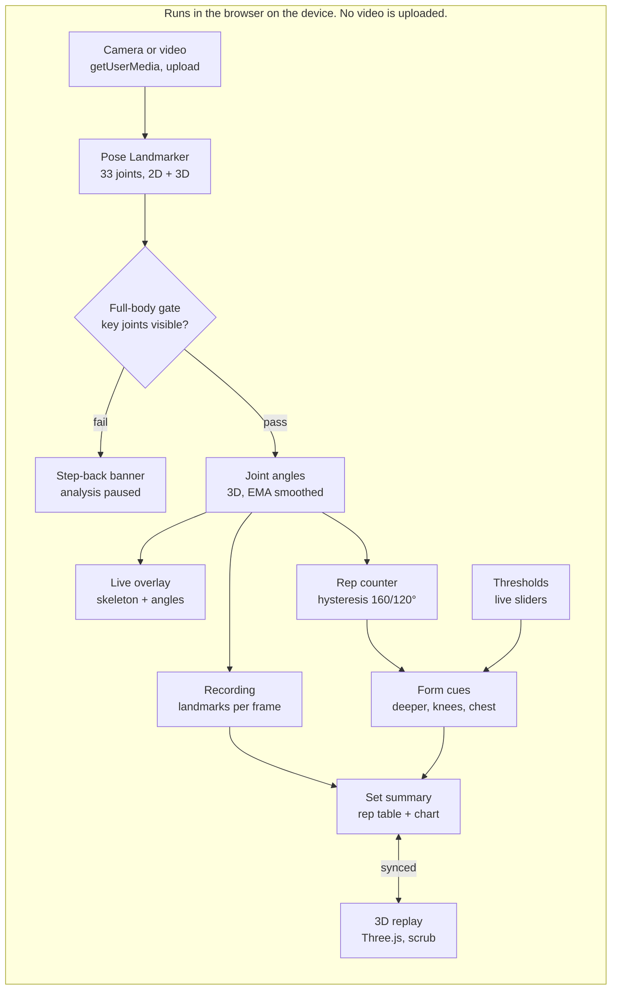

# Squat Analyzer POC – Technical Overview

HexaCoder Technologies · 24 Nov 2026

## Overview

The Squat Analyzer POC is a single web page that turns a phone or laptop camera into a squat coach: live joint angles, a rep counter, form cues, a set summary and a 3D replay. All pose estimation runs in the browser on the user's device; video frames are never uploaded or stored on a server.

The page is one self-contained file (`index.html`, about 600 lines of HTML, CSS and JavaScript) with no build step and no backend. It covers all seven stated requirements plus the optional left-vs-right range-of-motion check. Third-party libraries are loaded from a public CDN; all squat-specific logic was written for this POC.

## Architecture



Frames that fail the full-body gate stop at the banner. Passing frames feed the live overlay, the rep counter with its form cues, and a recording buffer that powers the summary and the 3D replay.

## Strategies

Every decision is rule-based on joint geometry, so behaviour is explainable and tunable without training data.

| Strategy | How it works | Why |
| --- | --- | --- |
| On-device pose estimation | MediaPipe Pose Landmarker (full model) returns 33 body landmarks per frame, both in image coordinates and in 3D world coordinates (metres, hip-centred). | No video leaves the device; runs in real time on phone and laptop GPUs. |
| 3D angles from world landmarks | Knee = hip–knee–ankle, hip = shoulder–hip–knee, computed from the 3D vectors with the dot-product formula. | Angles stay stable when the user turns slightly away from the camera, unlike 2D pixel angles. |
| Full-body gate (setup check) | Shoulders, hips, knees and ankles must each have confidence ≥ 0.5 and sit inside the frame. Otherwise analysis pauses and a banner names the missing parts. | Prevents phantom reps and wrong angles when limbs are cut off. |
| Smoothing | Exponential moving average on every angle (factor 0.5 by default). | Removes landmark jitter that would cause false cues. |
| Rep state machine with hysteresis | A rep starts when the mean knee angle drops below 160°, is armed only when it goes below 120°, and completes on return above 160°. | Two separate thresholds filter out small bobs and partial movements. |
| Rule-based form cues | During each armed rep: lean > 45° → "Keep chest up"; front view and knee/ankle width ratio < 0.85 → "Push knees out"; bottom knee angle > 95° → "Go deeper". Each cue fires once per rep. | Short, actionable coaching that maps directly to a measurable threshold. |
| View detection | Front view when shoulder width across the image exceeds shoulder depth by 1.2×; otherwise side view. | Knee-cave (valgus) is only measurable from the front, so that cue is limited to front view. |
| Range-of-motion comparison | Tracks the maximum shoulder angle (arm raise) or knee flexion (knee bend) per side and reports the left–right asymmetry %, flagged above 10%. | Covers the optional ROM requirement with the same angle engine. |

The formula used for every joint angle, where B is the joint (e.g. knee) and A and C are the neighbouring landmarks (hip and ankle):

```
θ = arccos( (BA · BC) / (|BA| × |BC|) )
```

## Libraries and tech stack

Three open-source libraries, all under permissive licences, plus standard browser APIs. Nothing is installed; everything loads from the jsDelivr CDN at page load.

| Library | Version | Role in the POC | Licence |
| --- | --- | --- | --- |
| [MediaPipe Tasks Vision – Pose Landmarker](https://ai.google.dev/edge/mediapipe/solutions/vision/pose_landmarker) (Google) | 0.10.14, full float16 model | 33-landmark pose detection per frame (image + 3D world coordinates), GPU with CPU fallback | Apache 2.0 |
| [Chart.js](https://www.chartjs.org/) | 4.4.1 | Knee-angle-over-time chart, rep bands, threshold lines, click-to-seek cursor | MIT |
| [Three.js](https://threejs.org/) + OrbitControls | 0.160.0 | Interactive 3D skeleton replay (rotate, zoom, scrub) | MIT |
| Browser APIs | – | `getUserMedia` (camera), `<video>` (uploaded files), Canvas 2D (overlay), WebGL, Web Speech (voice cues), `localStorage` (saved thresholds) | – |

Runtime requirement: a modern browser on HTTPS or localhost, because browsers expose the camera only on secure origins.

## Implementation

Each requirement maps to one part of the code; the per-frame pipeline runs inside a `requestAnimationFrame` loop.

| # | Requirement | Implementation |
| --- | --- | --- |
| 1 | Camera or uploaded video | `getUserMedia` with front/back camera choice; uploaded files play in a hidden `<video>` and are analysed as they play, with the set starting and ending automatically. |
| 2 | Setup check | Full-body gate (see Strategies); the red banner lists missing joints, e.g. "missing: L ankle, R ankle". |
| 3 | Live overlay | Each frame is drawn to a canvas (mirrored for the front camera), then the skeleton, colour-coded left (blue) and right (orange), with knee and hip angle labels. A HUD shows L/R knee, hip and lean. |
| 4 | Rep counter | Hysteresis state machine; each completed rep stores start, end and bottom time, minimum knee and hip angle, maximum lean, and knee/ankle ratio. |
| 5 | Form feedback | Rule checks run during the armed phase; cues show as an on-screen banner for 1.8 s and can be spoken. All thresholds are live sliders, saved in the browser. |
| 6 | Summary | Stats (total reps, good reps, average and best depth, average lean, duration), a per-rep table with cues, and a Chart.js knee-angle chart with shaded rep bands and dashed threshold lines. |
| 7 | 3D replay | Every recorded frame stores the 33 world landmarks (99 floats). Three.js draws joints and bones on a floor grid; a slider and Play button scrub through the set. Clicking the chart or a table row seeks the replay, and a cursor line on the chart follows it. |
| + | Range of motion | Arm-raise and knee-bend modes with L/R bars, maximums and an asymmetry verdict. |

Default thresholds, all tunable from the Thresholds panel:

| Threshold | Default | Effect |
| --- | --- | --- |
| Standing knee angle | ≥ 160° | Rep starts below and completes above this |
| Squat counts when knee | ≤ 120° | Filters out bobs and partial reps |
| Go deeper if bottom knee | > 95° | Depth cue |
| Keep chest up if torso lean | > 45° | Lean cue |
| Push knees out if knee/ankle width | < 0.85 | Knee-cave cue, front view only |
| Landmark confidence | ≥ 0.5 | Strictness of the full-body check |
| Angle smoothing | 0.5 | Higher is smoother but adds lag |

## Validation, limitations and next steps

The rep and cue logic passed a synthetic self-test; live testing with real users is the next step.

**Validation done.** A built-in self-test (`?selftest` in the URL) feeds a generated squat sequence through the same pipeline: four squats (deep, shallow, over-leaning, deep) plus one small bob. Result: 4 reps counted, the bob ignored, "Go deeper" on the shallow rep and "Keep chest up" on the leaning rep. The chart, table and 3D replay rendered and stayed in sync. The pose model loaded on GPU.

**Limitations**

- Not yet tested with real people, lighting and camera placements; thresholds may need tuning.
- Camera angle matters: depth and lean read best side-on or at 45°; the knee-cave cue works only in front view.
- World-landmark depth and the vertical axis follow the camera, so a tilted phone shifts lean readings.
- The 3D replay shows the skeleton only, not the original video.
- Phones need the page on an HTTPS URL; today it runs on localhost on the development laptop.

**Next steps**

1. Run 3–4 live test sessions (side view, front view, shallow reps, uploaded video) and tune default thresholds.
2. Host on an HTTPS URL for phone testing.
3. Optionally relax the full-body gate (one visible side, shoulders optional) for close-up phone framing.
